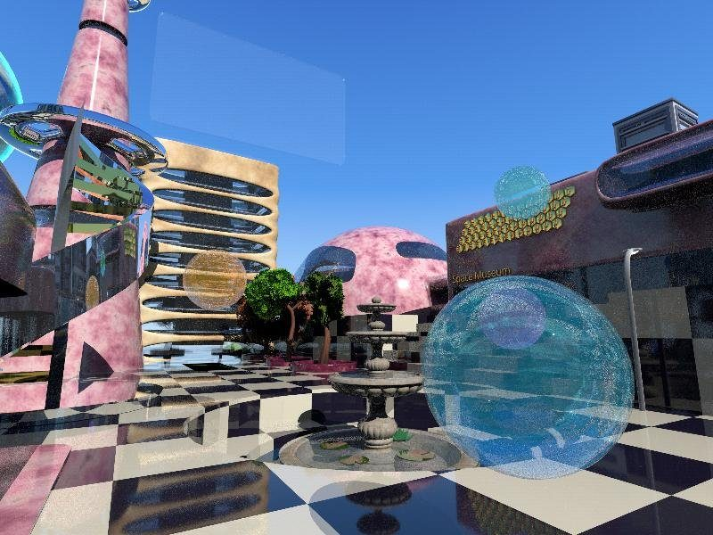
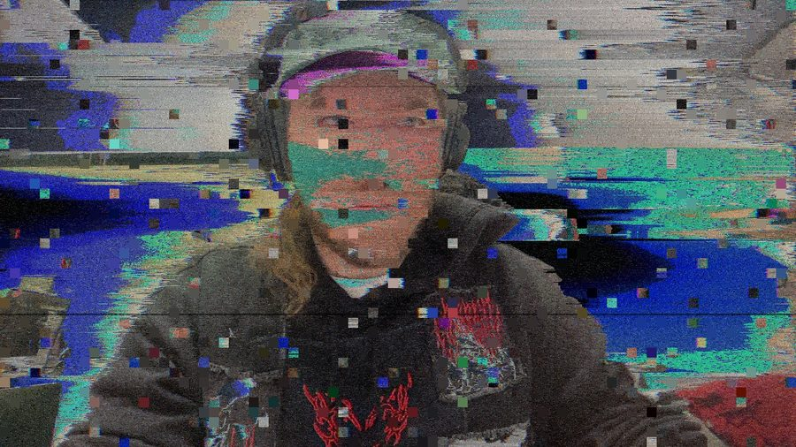

# Coleman Rose

**Senior Software Engineer · Engineering Lead @ 255 PIX Studio** | Helsinki, Finland

*I build interfaces, the systems behind them, and tools that break images on purpose.*

---

### About

Senior software engineer with 7 years of experience, from React and TypeScript products to the pipeline tooling behind VFX work. At **255 PIX Studio** I lead engineering: plugins and scripts for Nuke and DaVinci Resolve, an automation system that ties production tracking to render-farm-style job scheduling, and AI image and video workflows in ComfyUI.

After hours I'm making a horror game in Godot and a shader-driven image editor. The full story, with live WebGL, is at **[colemanro.se](https://www.colemanro.se/)**.

---

### What I'm making

<table>
  <tr>
    <td width="50%" valign="top">
      
      <h4>Absolution Engine · solo game · Godot 4</h4>
      First-person claims-desk horror. You work the desk for an insurer that sells absolution: weigh each client's sins against the plan they bought, then seal the verdict. 94 custom shaders, 4 luxury sims, 1 developer.
        
      <a href="https://www.instagram.com/absolutionengine/">Instagram</a> ·
      <a href="https://www.tiktok.com/@absolutionengine">TikTok</a> ·
      <a href="https://www.youtube.com/@AbsolutionEngine">YouTube</a>
    </td>
    <td width="50%" valign="top">
      
      <h4>Erosion Studio · desktop app · in development</h4>
      A photo and video editor built around 55+ custom WebGL shaders. Effects stack like layers, video gets a timeline, and everything exports to PNG, GIF, MP4 or WebM. Closed source for now.
        
      Electron · React · Three.js · GLSL · FFmpeg
    </td>
  </tr>
</table>

**Also:**
- **Holographic shader**: the thin-film interference finish on my [portfolio](https://www.colemanro.se/), the same physics that colours soap bubbles, running through a single WebGL layer.
- **[Tachyon](https://github.com/ColemanSWE/tachyon)**: an HTTP/1.1 forward proxy in Rust (Tokio), built to learn the language.
- **[HSL Live Tracker](https://colemanswe.github.io/hsl-live-tracker/)**: real-time Helsinki public transport map over MQTT.

---

### Tech Stack

**Pipeline & creative tooling**

**Frontend & graphics**

**Backend & infrastructure**

**Systems**

Earlier work also covered GraphQL, Redux, Jest, Cypress and Ruby on Rails.

---

Pappa codes better than he gives belly rubs. He deserves treats... I mean, a job. — Lulu, professional cat

